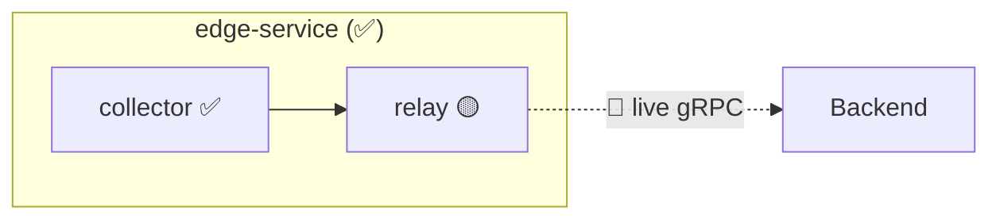
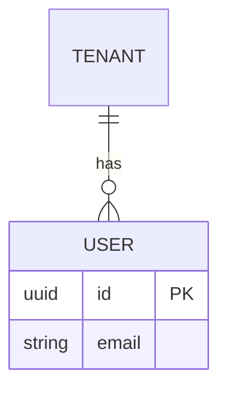

# Repo rules
- Mermaid **inside the `.md`** (GitHub renders it). Show **packages** (dashed frame = same executable + table of what each holds), **how it should be** per documentation and standing decisions (ADRs), and **status per part**: ✅ exists · 🟡 partial · 📝 only recorded · ❓ open (dashed line = does not exist yet). Status verified in code or `not verified`.
- Reuse an existing diagram: search the docs first. Update instead of duplicating. Do not delete legacy PlantUML; if updating one, migrate it to Mermaid in the owning `.md` and leave a note.

# Pick the type
| To show | Mermaid | Source of truth in code |
|---|---|---|
| Containers/processes | `C4Container` or `flowchart` with `subgraph` | orchestrator, compose file, build features |
| Data flow | `flowchart LR` | routes, message handlers, RPCs |
| Interaction over time | `sequenceDiagram` | controller → service → repo; RPC call |
| Entities | `erDiagram` | domain model + ORM config/snapshot |
| Package dependencies | `flowchart` | project references, `pubspec.yaml` `path:`, `cargo tree` |
| States | `stateDiagram-v2` | enum + transitions in the service |

# Steps
1. **Extract from code, not memory**: `grep`/reading (or the command in the table).
2. Draw the **minimum** that answers the question: ≤ ~15 nodes; split if larger. Node name = real name in code.
3. State legend (✅🟡📝❓) and a package table alongside.
4. Put it in the owning `.md` (see `auto-doc-updater` matrix), next to the text that explains it; text and diagram change together.
5. **Validate**: syntax with `npx -y @mermaid-js/mermaid-cli@<pinned version> -i file.mmd -o /dev/null` **only if network and user approval allow** (installs a package); otherwise check GitHub preview and mark `render not verified`.
6. Generated diagrams (e.g. DB schema, dependencies) are never edited by hand: regenerate with the project script.

# Skeletons

# Do not
Invent entity/route/field · diagram without status marks · copy a diagram from another `.md` without re-checking · counts in diagrams · sizes nobody can read.
